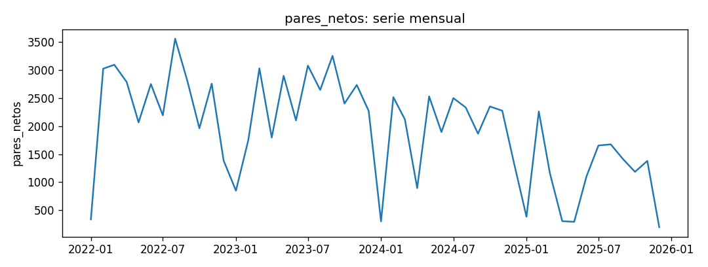
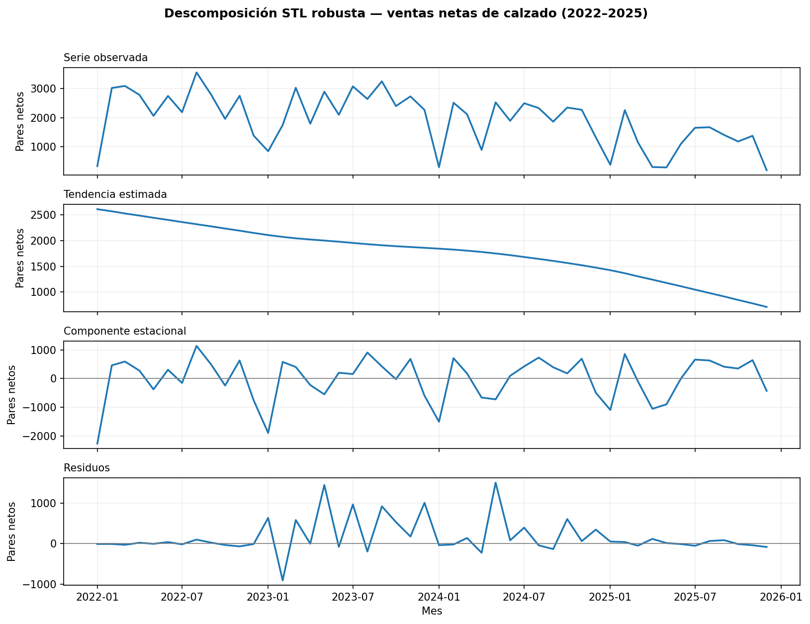
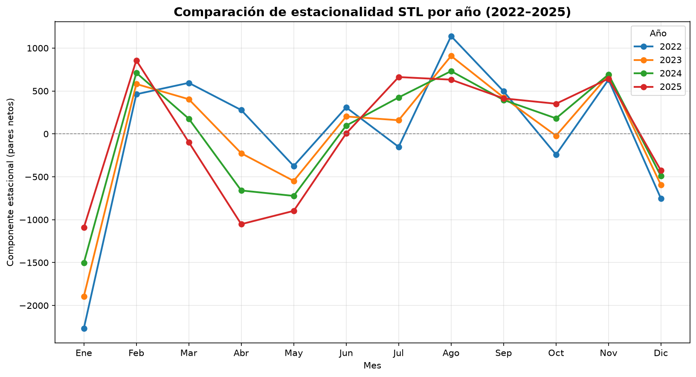
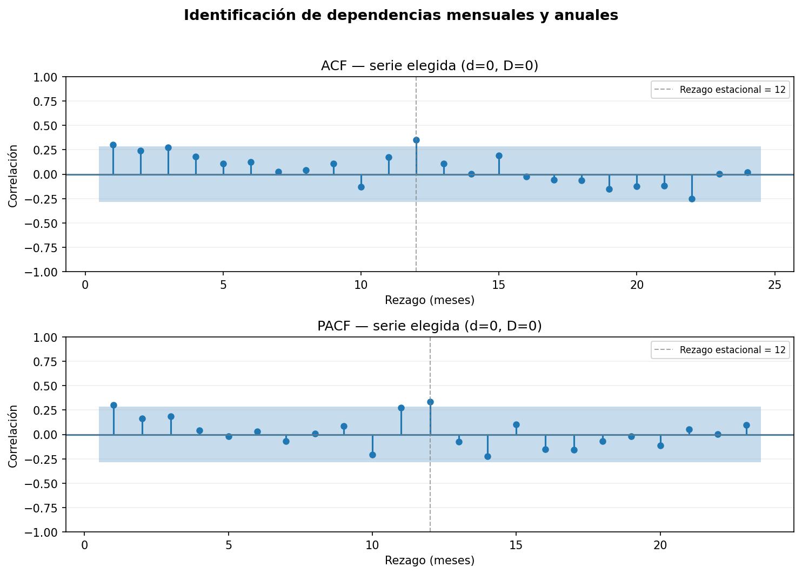
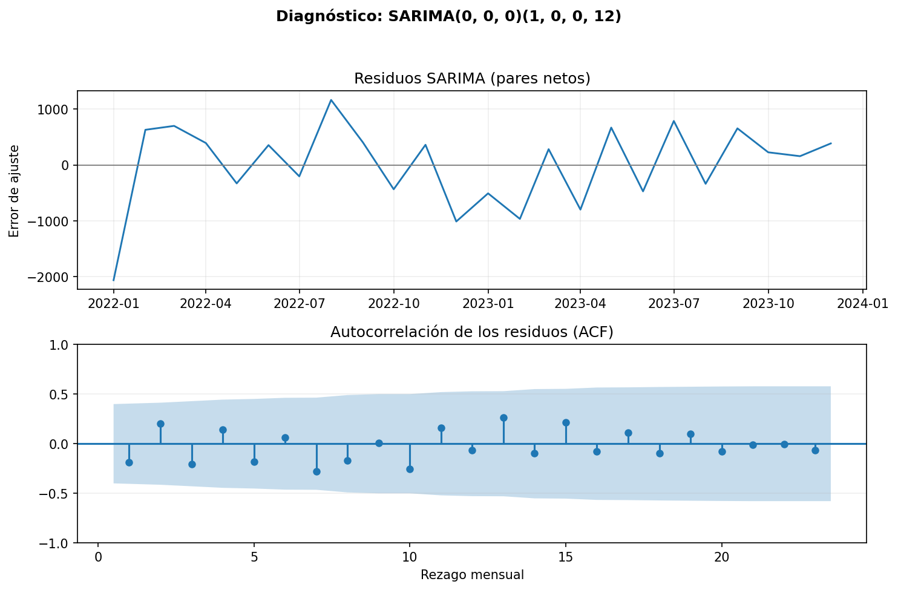
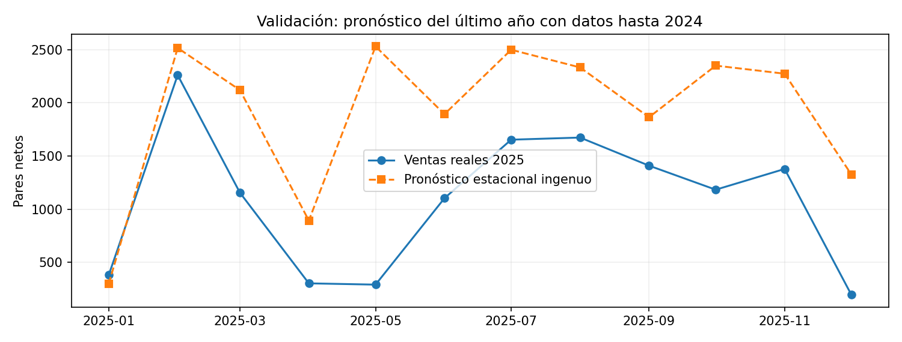

# Informe del miniproyecto 1

Informe reproducible de la serie mensual de ventas netas de calzado.
Las cifras corresponden a la ejecución local de `python miniproyecto.py`;
las gráficas se generan en `figuras/` y las tablas en `resultados/`.

**Reproducibilidad:** El proyecto se ejecuta con Python 3.12. Desde la raíz del repositorio se instalan las dependencias con `pip install -r requirements.txt` y se ejecuta `python miniproyecto.py`. El programa utiliza el CSV mensual agregado y genera las figuras y tablas de resultados, sin requerir el archivo empresarial original.

## 1. La serie

La serie corresponde a la **cantidad de pares netos vendidos mensualmente** por una empresa del sector calzado. Fue consolidada a partir de la columna `Pares` de la hoja `Detalle` del archivo empresarial anonimizado V2, conservando las devoluciones negativas. Abarca **enero de 2022 a diciembre de 2025**, con **48 observaciones mensuales consecutivas** y **93.411 pares netos** acumulados. Se eligió por su relación directa con la planificación comercial y de inventarios.

**Fuente y permiso:** información empresarial suministrada al grupo y resumida en un CSV mensual agregado que se publica en `datos/ventas_calzado_mensual_V2.csv` bajo autorización empresarial de divulgación confirmada por el grupo. La fuente empresarial original no es pública y no se ha declarado una licencia abierta para que terceros reutilicen los agregados. Además, 48 meses no alcanzan el mínimo de 60 requerido por el enunciado; el grupo solicitó una excepción al docente. Se preserva esta limitación sin añadir observaciones artificiales.



La serie **no tiene huecos** ni meses duplicados en la consolidación. Como verificación exploratoria de extremos se aplicó el criterio IQR sobre las ventas mensuales (Q1 = **1.366**, Q3 = **2.667,25** pares; límites de **−585,88** y **4.619,13** pares), que **no marca observaciones**. Esto no demuestra la ausencia de cambios comerciales extraordinarios: por ejemplo, mayo y diciembre de 2025 registran **292** y **197** pares, respectivamente. Se decidió **conservar todos los meses sin imputaciones, eliminación ni recorte**; esta decisión está implementada en `preparar()` y se traslada a la columna `decision` de las métricas. La interpretación comercial de los meses bajos sigue siendo una limitación.

## 2. Componentes



Se aplicó **STL robusta con periodicidad de 12 meses**, sin alterar la serie original. La descomposición aditiva representa las ventas de cada mes como:

$$y_t = T_t + S_t + R_t$$

Aquí $T_t$ es la tendencia suavizada, $S_t$ el componente estacional y $R_t$ el residuo. La tendencia estimada comienza en **2,613.84 pares** (2022-01) y finaliza en **709.08 pares** (2025-12), una diferencia de **-1,904.76 pares**. Es consistente con una disminución sostenida del nivel de ventas; las cifras son estimaciones de STL, no ventas observadas de esos meses.

Para interpretar la estacionalidad se calculó, por cada mes calendario, el **promedio del componente $S_t$ en los cuatro años**. La contribución promedio más alta corresponde a **agosto (+852.72 pares)** y la más baja a **enero (-1,689.18 pares)**. Estos efectos indican aumentos o disminuciones *respecto a la tendencia estimada*, no el total esperado de ventas de esos meses.

El residuo de mayor magnitud absoluta aparece en **2024-05 (+1,502.06 pares)**: es la parte de esa observación que no explica la suma de tendencia y estacionalidad. No puede atribuirse a una causa comercial específica sin otras fuentes. Con **solo cuatro ciclos anuales**, estos patrones son **exploratorios** y podrían verse afectados por los cambios de demanda de 2024–2025.

Los valores anteriores se imprimen directamente mediante `descomponer()` y su representación está en `figuras/stl.png`.

### Fortaleza de los componentes STL

Para cuantificar la importancia de la tendencia y la estacionalidad se calcularon las medidas de fortaleza de los componentes propuestas para la descomposición STL. Estas métricas toman valores entre 0 y 1, donde los valores más cercanos a 1 indican que el componente explica una mayor proporción de la variabilidad respecto al residuo.

Se utilizaron las siguientes expresiones:

```math
F_T = \max\left(0, 1 - \frac{\mathrm{Var}(R_t)}{\mathrm{Var}(T_t + R_t)}\right)
```

```math
F_S = \max\left(0, 1 - \frac{\mathrm{Var}(R_t)}{\mathrm{Var}(S_t + R_t)}\right)
```

Los resultados obtenidos fueron:

| Componente | Fortaleza STL | Interpretación |
|---|---:|---|
| Tendencia | 0.6028 | Presencia moderada de una tendencia en la serie. |
| Estacionalidad | 0.6939 | Patrón estacional relativamente marcado. |

La fortaleza estacional (0.6939) es superior a la fortaleza de tendencia (0.6028), lo que indica que el patrón estacional presenta una señal ligeramente más fuerte que la tendencia según estas métricas. Sin embargo, ambos componentes son relevantes para describir el comportamiento de las ventas.

Los valores calculados se almacenan en resultados/fuerza_componentes.csv, permitiendo su consulta y reproducción.

### Comparación del componente estacional por año


Se construyó una gráfica comparativa del componente estacional obtenido mediante STL para los años 2022, 2023, 2024 y 2025. En ella se representan los doce meses de cada año, lo que permite examinar visualmente las similitudes y diferencias del comportamiento estacional a lo largo del periodo estudiado.

Esta representación complementa el promedio mensual de estacionalidad presentado anteriormente, ya que permite observar la variabilidad del componente entre años y evaluar visualmente la estabilidad del patrón anual.

Dado que se dispone únicamente de cuatro ciclos anuales, las diferencias observadas deben interpretarse de manera exploratoria y no permiten afirmar que el patrón estacional permanecerá constante en periodos futuros.

## 3. Líneas base y backtest

Se utilizó el **backtest de `comun.py` sin modificaciones**, con 24 meses finales destinados al esquema de evaluación por orígenes móviles y un horizonte de **12 meses** en cada origen. Con 48 observaciones, se evalúan **13 orígenes** entre **diciembre de 2023 y diciembre de 2024**. Para cada origen, las funciones de pronóstico reciben únicamente la serie de entrenamiento disponible hasta ese momento; el pronóstico se contrasta con los 12 meses siguientes. El promedio de métricas corresponde a la **media de las 13 métricas por origen**, no a una RMSE agrupada por todos los errores.

El primer origen utiliza **24 meses de entrenamiento** (solo dos ciclos anuales), limitación derivada de tener 48 meses totales. Esta restricción se deja explícita por la exigencia de al menos 60 observaciones y no se modifica el procedimiento compartido.

| Línea base | RMSE (pares) | MAE (pares) | MAPE (%) |
|---|---:|---:|---:|
| Ingenuo | 1081.80 | 887.45 | 138.60 |
| Estacional ingenuo | **842.94** | **680.98** | **90.89** |

La línea **estacional ingenua** obtiene el menor RMSE (mejora del **22.08 %** frente a la ingenua), y también menores MAE y MAPE. Los MAPE son elevados porque algunos meses tienen ventas bajas y el error porcentual se amplifica. Estos son los resultados que el SARIMA y SARIMAX deberán intentar superar.

## 4. Estacionariedad e identificación

Se aplicó la **prueba Dickey-Fuller aumentada (ADF)** bajo la hipótesis nula **H₀: existe una raíz unitaria** y con nivel de significancia del 5 %. Se evaluaron la serie original, la diferencia regular (lag 1), la diferencia estacional (lag 12) y ambas diferencias; adicionalmente, la serie original **con constante y tendencia**, por la caída apreciada en STL. Para cada prueba, el número de rezagos ADF se eligió automáticamente por AIC.

| Transformación | Estadístico ADF | Valor p | Rezagos ADF |
|---|---:|---:|---:|
| Original | -4.725 | 7.5370133e-05 | 0 |
| Original con tendencia | -6.866 | 2.8386636e-08 | 0 |
| Diferencia regular | -5.545 | 1.6686566e-06 | 10 |
| Diferencia estacional (12) | -1.364 | 0.59942165 | 9 |
| Diferencia regular y estacional | -2.846 | 0.051982991 | 10 |

La serie original **rechaza H₀** tanto con constante (p = **7.5370133e-05**) como con constante y tendencia (p = **2.8386636e-08**). Como decisión inicial se adopta **`d = 0`**: diferenciar regularmente no parece indispensable para eliminar una raíz unitaria. La diferencia estacional no rechaza H₀ (p = **0.599422**), resultado que **no debe interpretarse como prueba de que `D = 1` es obligatorio**. ADF no es una prueba específica de raíces unitarias estacionales; se adopta provisionalmente **`D = 0`** por parsimonia y se representa el patrón anual mediante términos SARIMA estacionales (`P`, `Q`).

### Pruebas KPSS de nivel y tendencia

Como complemento a la prueba ADF, se aplicó la prueba de Kwiatkowski-Phillips-Schmidt-Shin (KPSS) sobre la serie original. A diferencia de ADF, cuya hipótesis nula establece la presencia de una raíz unitaria, KPSS plantea como hipótesis nula la estacionariedad de la serie.

Se evaluaron dos especificaciones: estacionariedad alrededor de un nivel constante (regression="c") y estacionariedad alrededor de una tendencia determinística (regression="ct"). En ambos casos se utilizó la selección automática de rezagos (nlags="auto") y un nivel de significancia del 5 %.

Los resultados fueron:

| Prueba | Estadístico KPSS | Valor p | Rezagos | Decisión (α = 0.05) |
|---|---:|---:|---:|---|
| KPSS de nivel (c) | 0.7134 | 0.01233 | 3 | Se rechaza H₀ |
| KPSS de tendencia (ct) | 0.1209 | 0.09643 | 0 | No se rechaza H₀ |

En la prueba KPSS de nivel, el valor p de 0.01233 es inferior a 0.05, por lo que se rechaza la hipótesis nula de estacionariedad alrededor de un nivel constante.

Por el contrario, en la prueba KPSS de tendencia, el valor p de 0.09643 es superior a 0.05, por lo que no existe evidencia estadística suficiente para rechazar la hipótesis nula de estacionariedad alrededor de una tendencia determinística.

Al considerar conjuntamente los resultados de ADF y KPSS, se encuentra evidencia compatible con una serie estacionaria alrededor de una tendencia determinística. En particular, ADF rechaza la presencia de una raíz unitaria en la serie original, mientras que KPSS de tendencia no rechaza la estacionariedad alrededor de una tendencia.

Estos resultados respaldan la decisión inicial de utilizar d = 0, aunque no garantizan que la serie sea estacionaria en sentido estricto. La selección definitiva de los modelos debe considerar también su desempeño predictivo y el diagnóstico de residuos.

Los resultados de ambas pruebas KPSS se almacenan en resultados/kpss.csv para facilitar su consulta y reproducción.



Para la **serie sin diferencias (`d = 0`, `D = 0`)**, la banda exploratoria aproximada al 95 % es **±0.283**. En la **ACF** sobresalen los rezagos **1 (r = 0.304)** y **12 (r = 0.351)**; en la **PACF** destacan también **1 (r = 0.304)** y **12 (r = 0.336)**. Se consideran, por ello, candidatos con **AR(1)** no estacional y **AR(1)** estacional de periodo 12. La inclusión de términos MA(1) y otras combinaciones se evaluará mediante AIC y diagnóstico de residuos en la siguiente sección, sin asignar el orden final solo por inspección visual.

**Limitaciones:** el rechazo de raíz unitaria por ADF **no demuestra estacionariedad estricta**, las bandas ACF/PACF son orientativas y los **48 meses** representan únicamente cuatro ciclos anuales. Los resultados estacionales y la elección de `D` deben interpretarse con cautela y contrastarse mediante ajuste y evaluación fuera de muestra.

## 5. Modelos clásicos

### Selección de órdenes sin anticipar meses del backtest

Para evaluar los candidatos SARIMA, se utilizó exclusivamente la **ventana de
24 meses entre enero de 2022 y diciembre de 2023**, que es el entrenamiento
disponible en el primer origen del `backtest` de `comun.py`. La selección se
realizó **una sola vez** con una rejilla de 16 especificaciones:
$p,q,P,Q\in\{0,1\}$, $d=0$, $D=0$ y periodo estacional 12. Se utilizó
una constante al no diferenciar la serie, con escalado numérico de 10; el
error se calcula siempre en **pares originales**.

Se preespecificó $d=D=0$ mediante la exploración inicial de la serie completa,
y se comprobó que la prueba ADF con constante en la ventana de 24 meses
rechazaba raíz unitaria ($p\approx 1.51\times 10^{-5}$). Esta decisión es
exploratoria y **no constituye una validación anidada completamente libre de
selección retrospectiva**. Una selección estrictamente anidada requeriría
determinar órdenes y diferencias de nuevo en cada origen usando solo los datos
históricos respectivos. Con apenas dos ciclos en el primer entrenamiento,
la identificación de estacionalidad anual es especialmente incierta.

El criterio de selección fue el **AIC mínimo entre ajustes convergidos**, sin
utilizar las ventas de 2024 ni 2025 para elegir órdenes. El AIC refleja ajuste
penalizado por complejidad; no garantiza menor error de pronóstico. Los
resultados calculados por la versión corregida del programa fueron:

| Orden regular | Orden estacional | AIC (24 meses) | Convergió |
|---|---|---:|---|
| `(0, 0, 0)` | `(1, 0, 0, 12)` | 278.20 | Sí |
| `(0, 0, 0)` | `(0, 0, 1, 12)` | 278.20 | Sí |
| `(1, 0, 1)` | `(1, 0, 0, 12)` | 279.57 | Sí |
| `(1, 0, 0)` | `(1, 0, 0, 12)` | 279.57 | Sí |
| `(0, 0, 0)` | `(0, 0, 0, 12)` | 279.73 | Sí |
| `(0, 0, 1)` | `(1, 0, 0, 12)` | 279.82 | Sí |
| `(1, 0, 0)` | `(0, 0, 1, 12)` | 279.86 | Sí |
| `(0, 0, 1)` | `(0, 0, 1, 12)` | 279.96 | Sí |
| `(1, 0, 1)` | `(0, 0, 1, 12)` | 280.13 | Sí |
| `(0, 0, 0)` | `(1, 0, 1, 12)` | 280.20 | Sí |
| `(1, 0, 0)` | `(1, 0, 1, 12)` | 281.37 | Sí |
| `(1, 0, 1)` | `(1, 0, 1, 12)` | 281.41 | Sí |
| `(0, 0, 1)` | `(1, 0, 1, 12)` | 281.71 | Sí |
| `(1, 0, 0)` | `(0, 0, 0, 12)` | 281.73 | Sí |
| `(0, 0, 1)` | `(0, 0, 0, 12)` | 281.73 | Sí |
| `(1, 0, 1)` | `(0, 0, 0, 12)` | 281.86 | Sí |

El mínimo corresponde a **SARIMA(0,0,0)(1,0,0,12)**, con **AIC = 278.2031**.
La alternativa SARIMA(0,0,0)(0,0,1,12) arroja **AIC = 278.2039**, una
**diferencia prácticamente nula**. Por tanto, la elección no debe
interpretarse como evidencia contundente de superioridad estructural.

El modelo seleccionado tiene una componente autorregresiva estacional de
periodo 12, sin términos AR o MA regulares. Su forma conceptual es:

```math
(1-\Phi_1 B^{12})(y_t-\mu)=\varepsilon_t
```

La rejilla íntegra se encuentra en `resultados/rejilla_aic.csv`. Los órdenes
seleccionados se mantienen durante el backtesting, pero **los parámetros se
reestiman en cada origen** exclusivamente con su entrenamiento.

### Diagnóstico de residuos



La prueba Ljung-Box contrasta la hipótesis nula de **ausencia de autocorrelación
hasta el rezago evaluado**. El diagnóstico se calculó con los residuos del
**mismo ajuste inicial de 24 meses** y su índice temporal correcto, descontando
1 grado de libertad por el coeficiente estacional AR. En vez de probar el
rezago 24 con apenas 24 observaciones, se utilizaron los rezagos **6 y 12**:

| Rezago | Estadístico Q | Valor p | Interpretación (5 %) |
|---:|---:|---:|---|
| 6 | 5.2027 | 0.391651 | No se rechaza H₀ |
| 12 | 13.6058 | 0.255576 | No se rechaza H₀ |

Estos resultados no aportan evidencia suficiente para rechazar ausencia de
autocorrelación bajo dichas pruebas, pero **no demuestran independencia de
los residuos**. La muestra de 24 meses y el número de parámetros limitan
la potencia estadística. El archivo `resultados/ljung_box.csv` conserva los
valores generados.

### SARIMAX con festivos de Colombia

Como exógena se utilizó el **número mensual de festivos de Colombia**, calculado
según las reglas de la Ley 51 de 1983 y el calendario de Pascua. El calendario
se conoce antes de cada pronóstico, sin incorporar ventas futuras. Se incluyeron
fechas de enero de 2022 a diciembre de 2026 para garantizar la cobertura de
los 12 meses posteriores a la serie.

La representación del modelo es:

```math
y_t = \beta_0 + \beta_1 x_t + u_t, \qquad
u_t \sim SARIMA(0,0,0)(1,0,0)_{12}
```

El ajuste descriptivo sobre los 48 meses estimó
**-14.57 pares por festivo**
($p=0.931424$). Con un valor $p$ mayor que 0,05 no se
encontró evidencia suficiente de asociación estadísticamente significativa;
este coeficiente **no demuestra causalidad**. Se registra en
`resultados/efecto_festivos.csv`.

### Comparación mediante backtesting

Se conserva **sin modificaciones `comun.py`**. Se evaluaron **13 orígenes
móviles**, cada uno con pronósticos de **12 meses**. En cada origen los
parámetros SARIMA/SARIMAX se ajustan con las ventas disponibles hasta ese
punto; el calendario futuro se utiliza solo como exógena conocida. Edison
incorporó el registro detallado de las métricas por origen en
`resultados/backtest_por_origen.csv`, incluyendo ambos métodos ingenuos y
los dos modelos paramétricos.

## 6. Tabla de métricas

Resultados de `resultados/metricas.csv`, ordenados por **RMSE promedio de los
13 orígenes**. RMSE y MAE se expresan en pares netos; MAPE es porcentaje.

| Modelo | RMSE | MAE | MAPE (%) |
|---|---:|---:|---:|
| estacional ingenuo | 842.94 | 680.98 | 90.89 |
| SARIMA(0, 0, 0)(1, 0, 0, 12) | 851.25 | 704.41 | 114.01 |
| SARIMAX(0, 0, 0)(1, 0, 0, 12) + exógenas | 885.71 | 709.88 | 114.55 |
| ingenuo | 1081.80 | 887.45 | 138.60 |

**Decisión de preparación (columna `decision` del CSV):** 48 meses consecutivos,
sin faltantes; no se imputaron ni recortaron valores. Los meses de ventas
muy bajas de 2025 requieren interpretación comercial. El MAPE es sensible
a estas observaciones de magnitud pequeña.

La línea base **estacional ingenua** obtuvo el menor RMSE
(**842.94 pares**). El SARIMA seleccionado presentó
**851.25 pares** y el SARIMAX con festivos
**885.71 pares**. En esta evaluación, la mayor complejidad no
mejoró el RMSE frente a la referencia estacional.

## 7. Conclusiones y limitaciones

La selección de órdenes con los primeros 24 meses evita utilizar las ventas de
los meses posteriores en la **rejilla AIC**. Sin embargo, la decisión preliminar
sobre $d$ y $D$ y parte de la exploración de estacionariedad se documentaron
con los 48 meses; no debe afirmarse que el proceso completo constituye una
selección anidada. El desempeño se estima mediante el backtest común y la
selección AIC tiene incertidumbre apreciable con tan pocos ciclos.

El mejor modelo por RMSE es **estacional ingenuo (842.94 pares)**,
y no el SARIMA parametrizado. La exógena de festivos tampoco mejoró el error.
El diagnóstico Ljung-Box no halló evidencia suficiente de autocorrelación
para el modelo elegido en la ventana inicial, con las limitaciones señaladas.



Para 2025, la referencia estacional pronosticó **22.902 pares** utilizando
los valores de 2024, mientras que se observaron **12.998 pares**. Esta
sobreestimación muestra los límites de repetir el patrón anual cuando el
nivel de ventas cambia.

**Limitaciones académicas:** la serie privada agregada tiene **48 meses**, en
lugar de los 60 solicitados por el enunciado. La empresa autorizó su
publicación agregada, pero no se ha documentado una licencia abierta de
reutilización por terceros. Se solicitó al profesor una excepción y se
mantiene explícita esta restricción, sin inventar observaciones adicionales.

**Proyección:** evaluar más historia, revisar los cambios comerciales de 2025,
considerar validación anidada de órdenes y comparar modelos adicionales en el
siguiente miniproyecto.
